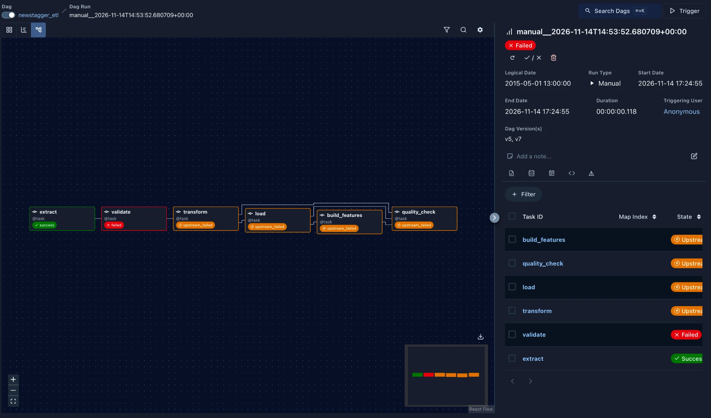
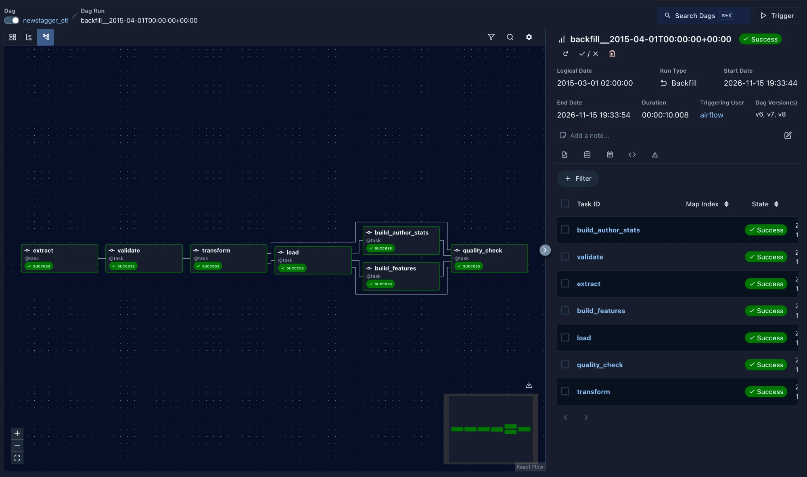
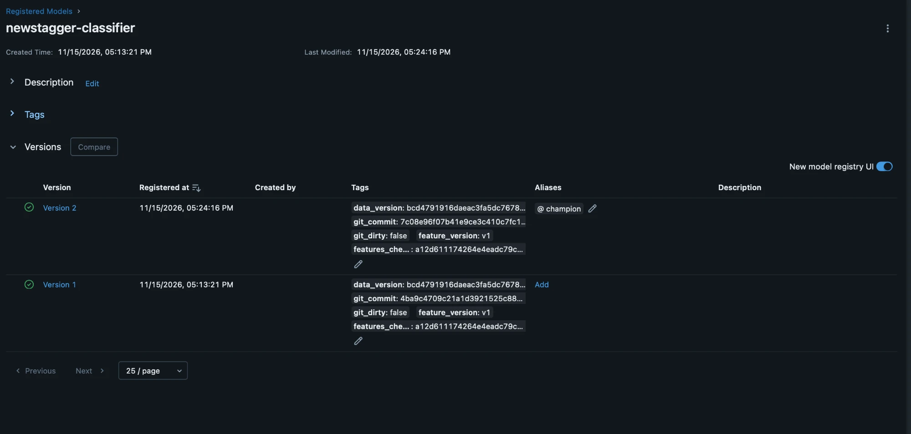

# NewsTagger: news category classification that keeps learning

A news publisher needs a section category for every new article, and editors choosing it by hand is slow and inconsistent.
NewsTagger suggests the top-3 categories from the headline and short description when the article is submitted.
Editors' final choices come back as labels, and the model is retrained monthly as topics drift.
The system watches its own inputs, predictions and override rate, and alerts a human when quality drops.
Data: [HuffPost News Category Dataset](https://www.kaggle.com/datasets/rmisra/news-category-dataset) (R. Misra, CC BY 4.0), ~210k articles 2012–2022, replayed month by month.

Design document: [docs/design.md](docs/design.md)

## Reproduce from a clean clone

Needs Docker Desktop, `uv` and `make`. Ports used on localhost: 5001 (MLflow), 5433 (Postgres), 8080 (Airflow), 9000/9001 (MinIO).

```bash
cp .env.example .env              # placeholder secrets are fine for a local run
docker compose up -d --build      # MinIO, Postgres, Airflow 3.3.1, MLflow 3.16.1
make setup                        # pinned Python environment + pre-commit hook
make lint                         # ruff
make data-pull                    # raw data from the DVC remote on MinIO
docker compose exec airflow-scheduler airflow dags unpause newstagger_etl
docker compose exec airflow-scheduler airflow backfill create --dag-id newstagger_etl --from-date 2012-01-01 --to-date 2018-05-01
make register                     # train, log to MLflow, register a version (needs a clean git tree)
make promote VERSION=1            # move the champion alias
make reproduce VERSION=1          # rebuild that version from its commit and data, compare within 0.005
make feast-apply && make feast-demo
```

The backfill runs 77 monthly batches one at a time (about 15–20 min; progress at http://localhost:8080). Unpausing also schedules the latest month (2026-10), which has no data, so its `quality_check` fails with `empty batch`: that is the gate working. On a fresh MLflow the first registered version is 1.

## Data (step 2)

HuffPost News Category Dataset v3, 209,527 rows, 87 MB, not sampled. Versioned with DVC 3.67.1; remote: MinIO (S3-compatible) in Docker, bucket `dvc`. `make data-pull` retrieves `data/raw/News_Category_Dataset_v3.json`, md5 `bcd4791916daeac3fa5dc76786dd8bd5`.

## Pipeline (step 3)

DAG `newstagger_etl` (`dags/newstagger_etl.py`): `extract → validate → transform → load → build_features ∥ build_author_stats → quality_check`. The batch is the run's data interval, never the current time: the schedule is declared as `CronDataIntervalTimetable("@monthly", timezone="UTC")`, so each run covers `[data_interval_start, data_interval_end)`, one calendar month. To run one month by hand, trigger with the first day of the *next* month as the logical date (2015-04-01 processes March 2015).

**Idempotency.** `load` deletes the run's month, then inserts it, in one transaction (`DELETE FROM clean_articles WHERE batch_month = %s`). The same interval run twice:

| Run | March 2015 rows in `clean_articles` |
|---|---|
| first run | 2,670 |
| second run (Clear) | 2,670 |

The full history rerun as a second backfill (`--reprocess-behavior completed`) left every table unchanged: `clean_articles` 200,759 → 200,759, `features` 200,759 → 200,759.

**Quality gate.** Tested by triggering April 2015 (logical date 2015-05-01) with the run parameter `inject_fault = empty_headlines`, which blanks every second headline of that run's staging copy only (1,287 of 2,573). `validate` failed with `Validation failed: empty headline rate 50.0% > 1%`; `transform`, `load` and `quality_check` never ran, and no April rows reached the database. Gates fail without retry.




## Features (step 4)

Table `features` (`feature_version = v1`), one row per article; the serving-time source of every feature is in design doc section 5.3. Author features use only months before the article's month.

**Feast (optional):** entity `author`, feature view `author_stats`; offline and online stores in Postgres. `make feast-demo`:

```
author '24/7 Wall St., ContributorSpecial Report' has feature rows:
  2016-10-01: author_top_category=WELLNESS, author_n_articles=1
  2017-01-01: author_top_category=BUSINESS, author_n_articles=3
Feast at 2016-11-16 (between the two rows): WELLNESS, 1
PASS: returned the earlier row
Feast vs training features table: 1790 (author, month) pairs, 0 mismatches
```

After `make feast-materialize`, `make feast-online AUTHOR="24/7 Wall St., ContributorSpecial Report"` returns the latest values: `BUSINESS, 3`.

## Baseline vs model (step 5)

Time split: train 2012-01 → 2016-12, validation 2017, test 2018-01 → 2018-05 (design doc 5.4).

| Model | Valid macro-F1 | Test macro-F1 | Test accuracy | Test top-3 |
|---|---|---|---|---|
| Majority class (WELLNESS) | 0.003 | 0.000 | 0.002 | n/a |
| Author rule | 0.366 | 0.248 | 0.494 | n/a |
| TF-IDF + logistic regression | 0.388 | 0.324 | 0.616 | 0.860 |

The model beats both rules; the author rule, using no text, comes within 0.022 on validation.

## Tracking and registry (step 6)

MLflow server at http://localhost:5001: Postgres backend store, MinIO artifact store. Every run logs its parameters, metrics and lineage tags `data_version` (DVC md5), `git_commit`, `feature_version`, `features_checksum`. Registered model `newstagger-classifier`: version 2 is `@champion`, tagged `data_version=bcd4791…`, `git_commit=7c08e96`.

`make reproduce VERSION=2` checks out the commit, pulls and verifies the data, retrains and compares; tolerance ±0.005 test macro-F1:

```
PASS: test_macro_f1 0.3238 vs version 2 0.3238 (|diff| 0.0000, tolerance 0.005)
```



## Maturity scorecard

| Property | Evidence a reviewer checks | Added in |
|---|---|---|
| Repository reproducible from a clean clone | CI is green; `make setup` and `make lint` succeed on a fresh clone | Lab 1 |
| Design document exists and is current | `docs/design.md` follows the template, every section filled or marked as an assumption | Lab 1 |
| Data versioned | `make data-pull` retrieves the raw data, md5 `bcd4791…` ([Data](#data-step-2)) | Lab 2 |
| Pipeline idempotent | the same interval twice: 2,670 / 2,670 rows; full rerun: 200,759 / 200,759 ([Pipeline](#pipeline-step-3)) | Lab 2 |
| Quality gate present | `inject_fault=empty_headlines` fails `validate`, screenshot ([Pipeline](#pipeline-step-3)) | Lab 2 |
| Experiments tracked | every MLflow run has parameters, metrics, `data_version` and `git_commit` ([step 6](#tracking-and-registry-step-6)) | Lab 2 |
| Model registered with lineage | `newstagger-classifier` v2 `@champion`, tagged with data version and commit; `make reproduce VERSION=2` → PASS | Lab 2 |
