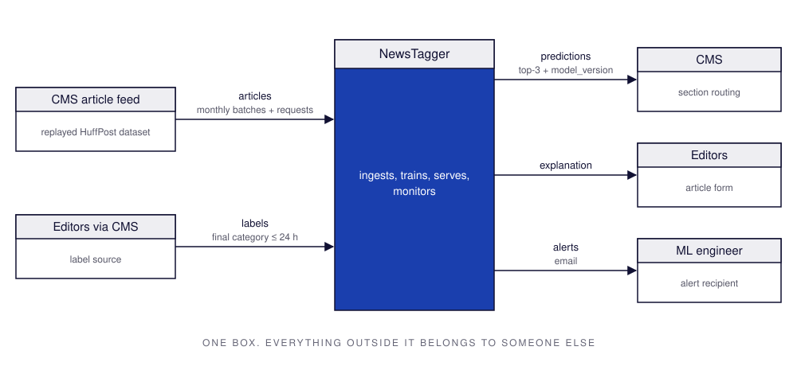
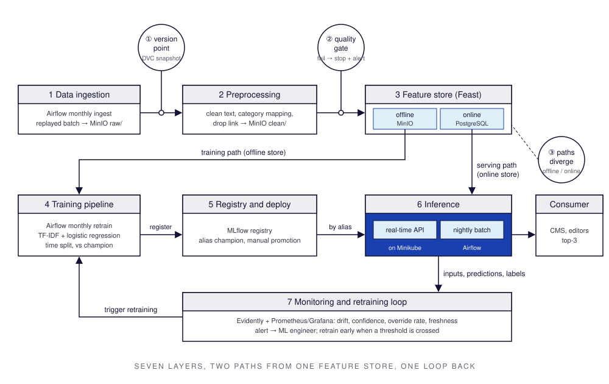
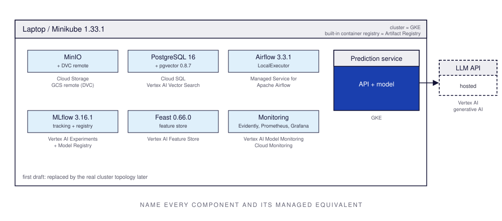

# Design document: NewsTagger

## 1 Overview

A news publisher publishes about 100 articles a day, and editors choose each article's section category by hand, which is slow and inconsistent. The set of topics keeps changing as new stories appear, so fixed rules go out of date. NewsTagger suggests the three most likely categories for each article, from its headline and short description, at the moment it is submitted. It learns from editors' corrections and is retrained every month. Editors accept the top suggestion for most articles, and the system notices and reports when its quality drops instead of failing silently.

**Assumption:** the publisher is hypothetical; the HuffPost News Category Dataset (2012–2022) stands in for its article history and is replayed month by month as the incoming feed. The volume of ~100 articles/day is an assumption used for sizing throughout this document.

## 2 Motivation

A one-off notebook could classify the 2012–2018 archive once, but it would be out of date with the next news cycle: in 2020, COVID coverage reshaped the health, wellness and politics sections within weeks. NewsTagger needs to be a running system because:

- **Who consumes the predictions:** the publisher's CMS, which requests a category for every submitted article, and the editors, who see the top-3 suggestions in the article form and confirm or correct them.
- **How often:** for every article at the moment it is submitted, about 100 times a day, with bursts during breaking news. The editor is waiting, so a suggestion must arrive within about a second. Editors' final choices come back as labels the same day.
- **What happens when they are wrong:** the article appears in the wrong section and reaches fewer of its intended readers until an editor notices, and each correction costs about a minute of editor time. A single error is cheap, but many errors add up, so the system must detect when its error rate rises rather than fail silently.

**Assumption:** a correction costs about one minute of editor time; the CMS waits at most one second for a suggestion before showing the form without one.

## 3 Success metrics

| Layer | Metric | Target / assumption | Type |
|---|---|---|---|
| Business | **Editor override rate**: share of articles whose final category differs from NewsTagger's top-1 suggestion, measured weekly | ≤ 25 % in the first three months, ≤ 15 % after | Optimizing |
| Model | **Macro-F1** on the time-held-out test period; **top-3 accuracy** as secondary | Macro-F1 ≥ trivial baseline + 0.10; top-3 accuracy ≥ 0.85 | Optimizing |
| System | **p95 latency** of a prediction request; **model freshness** (age of the newest data the serving model was trained on) | p95 ≤ 300 ms; freshness ≤ 35 days (monthly retraining plus slack) | Satisficing |

## 4 Requirements and constraints

### 4.1 Functional

| # | Requirement | Caller | Input | Output |
|---|---|---|---|---|
| FR1 | Predict category | CMS, on article submit | article_id, headline, short_description, authors, submitted_at | top-3 categories with probabilities, model_version |
| FR2 | Record label | CMS, when editor publishes | article_id, final_category, decided_at | stored label |
| FR3 | Batch scoring | Scheduler, nightly | articles not scored online | predictions in the database |
| FR4 | Retrain | Scheduler, monthly | new month of labeled articles | candidate model compared with current model |
| FR5 | Monitor | Scheduler, daily | predictions, inputs, labels | drift and quality report; alert to ML engineer |
| FR6 | Explain | Editor, from article form | article_id | short justification citing similar past articles |

### 4.2 Non-functional

| Category | Requirement |
|---|---|
| Freshness | Predictions made at submission time; serving model trained on data ≤ 35 days old (monthly retraining) |
| Latency and throughput | p95 ≤ 300 ms per request; sustained ~0.1 requests/s, peak 1 request/s |
| Availability and fallback | **Assumption:** 99 % during 06:00–24:00. If the current model fails to load, the service rolls back to the previous registered version. If the service is down or slower than 1 s, the CMS shows no suggestion and the editor chooses manually; publishing is never blocked. If top-1 confidence < 0.3, no suggestion is shown. Missed articles are scored by the nightly batch job |
| Reproducibility | Any registered model can be rebuilt from its git commit, data version and parameters with one command |
| Adaptability | New data enters monthly; a new category is added to the category list within 1 week and included in the next retraining |
| Observability without ground truth | Before labels arrive (≤ 24 h): prediction distribution drift, mean prediction confidence, share of unknown words. After labels: daily override rate, weekly macro-F1 |
| Cost and resource ceilings | Local: one laptop, CPU only, ≤ 8 GB RAM. Cloud estimate ≤ $800/month (see 6.7) |

### 4.3 Scope

**In scope:** one category per article for English-language articles, from headline and short description; real-time suggestions plus nightly batch scoring; monthly retraining; drift and quality monitoring with alerts; LLM explanation of suggestions; an agent that can look up and correct predictions.

**Out of scope:** full article text (not in the dataset); several categories per article; languages other than English; reader personalization and recommendations; integration with a real CMS (simulated by replaying the dataset).

## 5 Methodology
### 5.1 Problem statement

Multi-class, single-label text classification. Input: headline and short description, plus author and submission date. Output: a probability for each category; the top 3 are shown to the editor. **Assumption:** about 42 categories in the raw data, fewer after merging renamed duplicates.

**Rejected framing: multi-label classification.** Many articles fit more than one section, but the dataset has exactly one label per article, so there is no ground truth for multiple labels, and the CMS needs one primary section. Top-3 suggestions already show the editor the next most likely categories.

### 5.2 Data

**Source:** News Category Dataset v3 (R. Misra, Kaggle `rmisra/news-category-dataset`, CC BY 4.0): ~210k HuffPost articles, 2012–2022. Fields: `category, headline, short_description, authors, date, link`.

**Arrival pattern:** the dataset is replayed as monthly batches ordered by `date`, emulating a live feed.

**Labels and delay:** the label is the editor's final category. In the dataset it is present immediately; in the system it arrives ≤ 24 h after the prediction.

| Field | Training | Serving |
|---|---|---|
| headline, short_description | yes | yes, in request |
| authors | yes | yes, in request; new authors unseen |
| date | yes | yes, as `submitted_at` |
| link | yes | **excluded**: created after the category is chosen and may contain the section name (label leakage) |
| category | label | arrives ≤ 24 h later |

**Data checklist:**
- **Time axis:** `date` on every row, so monthly batches come directly from the data and none have to be manufactured.
- **Holdout period:** train 2012-01 → 2016-12, validate 2017, test 2018-01 → 2018-05. **Assumption:** most rows date from 2012–mid 2018; later months are sparser and are used as the future stream for drift replay.
- **Label delay:** immediate in the dataset; assumed ≤ 24 h in the system (editor decision).
- **Text corpus:** the articles themselves (headline and description) serve as the retrieval corpus for the LLM component.

### 5.3 Techniques

1. **Trivial baseline:** always predict the most frequent category in the training window (POLITICS).
2. **Candidate:** TF-IDF on headline + short description, followed by logistic regression with class weights for imbalance.
3. **Later:** an LLM with retrieval of similar past articles, compared against the candidate.

| Feature | Training source | Serving-time source |
|---|---|---|
| TF-IDF of headline + short_description | dataset fields | request body |
| day_of_week, month | `date` | `submitted_at` in request |
| author_top_category | computed from articles before the split date | feature store online table, refreshed daily; new author → "unknown" |

### 5.4 Experimentation and validation

**Split:** train 2012-01 → 2016-12, validation 2017 (tuning), test 2018-01 → 2018-05 (reported once). A random split would put articles about the same story on both sides and overstate the score. Author features are computed only from data before each split boundary.

**Offline metric:** macro-F1 (primary), top-3 accuracy (secondary).

**New vs current model (champion / challenger):** each month the challenger is trained on data up to month M−1, and both models are scored on month M. The challenger is promoted only if its macro-F1 is ≥ champion + 0.01 and no category with ≥ 50 test articles loses more than 0.05 recall.

### 5.5 Human in the loop

- **Drift alert:** reviewed by the ML engineer on call within 1 working day; decision is one of ignore, retrain early, or roll back.
- **Model promotion:** manual. The pipeline registers a challenger with its comparison report; the ML engineer reviews it and moves the `champion` alias. Rollback is moving the alias back.
- **Override:** editors choosing a different category than suggested; every override is stored as a label. The CMS can also switch suggestions off entirely with a feature flag.

## 6 Implementation
### 6.1 High-level design

#### System context

#### Data flow

#### Deployment (first draft)

### 6.2 Infra

| Component | Role in NewsTagger | Local (pinned) | GCP |
|---|---|---|---|
| Object storage | raw batches, cleaned data, model artifacts | MinIO-compatible `pgsty/silo` | Cloud Storage |
| Data versioning | snapshot of each raw batch | DVC 3.67.1 + dvc-s3 3.3.0, remote on MinIO | GCS remote |
| Database | predictions, labels, feature store online table | PostgreSQL 16 | Cloud SQL |
| Orchestrator | monthly ingest and retrain, nightly batch scoring | Airflow 3.3.1, LocalExecutor | Managed Service for Apache Airflow (formerly Cloud Composer) |
| Experiment tracking and registry | training runs, `champion` model | MLflow 3.16.1 | Vertex AI Experiments and Model Registry |
| Feature store | author_top_category, offline and online | Feast 0.66.0 | Vertex AI Feature Store |
| Container registry | images of the prediction service | Minikube built-in registry | Artifact Registry |
| Cluster | runs the prediction service | Minikube 1.33.1 | GKE |
| Model monitoring | drift reports | Evidently | Vertex AI Model Monitoring |
| Metrics and dashboards | latency, errors, alerts | Prometheus, Grafana | Cloud Monitoring |
| Vector store | similar past articles for the LLM | pgvector 0.8.7 | Vertex AI Vector Search |
| LLM inference | explanations | hosted LLM API | Vertex AI generative AI |

### 6.3 Performance

**Decision: online inference, with a nightly batch job as a helper.** The editor is waiting in the article form, so the suggestion must be returned at submission time; a batch-only design would deliver it up to 24 h late. The nightly batch scores articles that missed the online call and builds the daily monitoring table.

| Budget | Value |
|---|---|
| p95 latency per request | ≤ 300 ms: ~20 ms feature lookup, ~10 ms model, rest network and serialization |
| Throughput | ~0.1 requests/s sustained, 1 request/s peak; one replica with 0.5 CPU and 512 MB RAM |
| LLM explanation | asynchronous, excluded from the latency budget |

### 6.4 Security

Secrets (database password, MinIO keys, LLM API key) are kept in a git-ignored `.env` file locally, in Kubernetes Secrets on Minikube, and in Secret Manager in the cloud; none are committed. The prediction service is reachable only inside the cluster and requires an API key from the CMS. MLflow, Airflow and Grafana interfaces are bound to localhost.

### 6.5 Data privacy

The dataset contains public headlines and descriptions, and author names, which are personal data under GDPR even though they are public bylines. Author names are used only for the aggregated author feature and are not sent to the LLM. No reader data is collected. Data is kept until the end of the course (January 2027) and then deleted, including the DVC remote. The dataset is licensed CC BY 4.0; attribution is given in the README.

### 6.6 Monitoring and alarms

Logged per request: article_id, timestamp, model_version, top-3 categories with probabilities, latency. Inputs are kept for 90 days.

| Signal | Checked | Alert when | Alert to |
|---|---|---|---|
| Data freshness | each pipeline run | newest batch older than expected + 2 days, or identical to the previous batch | ML engineer |
| Quality gate | each ingest | any check fails | ML engineer |
| Prediction drift (PSI vs training) | daily | PSI > 0.2 | ML engineer |
| Mean top-1 confidence | daily | drops > 0.10 below 30-day mean | ML engineer |
| Unknown-word rate | daily | > 1.5× training rate | ML engineer |
| Override rate | daily, weekly average | weekly > 25 % | ML engineer, editor lead |
| Macro-F1 on last labeled week | weekly | drops > 0.05 below test score | ML engineer |
| p95 latency, error rate | continuous | p95 > 300 ms or errors > 1 % for 10 min | ML engineer |

Alerts are sent by email.

### 6.7 Cost

Estimated with the [Google Cloud pricing calculator](https://cloud.google.com/products/calculator?dl=CjhDaVE1T1RjeVl6QTBNQzFqWm1VMUxUUm1OVEV0WVdKaU1DMWpOemsxWW1ObU4yTmxOamtRQVE9PRApGiQwQTIyQjEyQS1GNjQwLTQ2NzgtQjkzMy02NkE1Q0Q2MDJGRTA) on 2026-10-19, region europe-west1, on-demand prices, 730 hours/month.

| Service | Sizing | $/month |
|---|---|---|
| Managed Service for Apache Airflow | Gen 3, small environment | 379.36 |
| Agent Platform Feature Store | 1 optimized online serving node; 3 node-hours ingestion | 219.24 |
| Agent Platform Vector Search | 1 × e2-standard-2 node; 210k vectors × 384 dims, rebuilt monthly | 76.24 |
| GKE | 1 zonal cluster, 2 × e2-medium, 30 GB standard disks | 128.01 |
| Cloud SQL for PostgreSQL | micro instance, 20 GB | 11.07 |
| Gemini 3.1 Flash Lite | 3,000 requests × 1,500 input + 200 output tokens | 2.05 |
| Artifact Registry | 5 GB | 0.45 |
| Cloud Storage | 10 GB standard | 0.10 |
| Cloud Monitoring | 10 custom metrics | 0.00 |
| Secret Manager | 5 secrets, 10k accesses | 0.00 |
| **Total (calculator)** | | **816.52** |
| **Total after GKE free-tier credit** (−$73 zonal cluster fee) | | **≈ 744** |

**Assumptions:** 100 articles/day; all services always on; no committed-use discounts.

Four always-on services (Airflow, Feature Store, Vector Search, GKE cluster fee) are ~92 % of the cost. First saving: replace the managed Feature Store with Feast's online store in the existing Cloud SQL instance (−$219/month).

### 6.8 Integration points

| Party | Direction | Contract |
|---|---|---|
| CMS article feed | upstream: articles | JSON with `article_id, headline, short_description, authors, submitted_at`; schema changes announced ≥ 2 weeks ahead; unannounced changes fail the quality gate |
| Editors (via CMS) | upstream: labels | `article_id, final_category, decided_at` within 24 h; category must be in the current category list |
| CMS | downstream: predictions | `POST /predict` returns top-3 and `model_version` within 1 s; no answer means no suggestion |
| ML engineer | downstream: alerts | email with signal, value and threshold; response within 1 working day |

### 6.9 Risks and uncertainties

| Risk | Mitigation |
|---|---|
| Post-2018 data too sparse to show drift | count rows per month; if too few, replay 2017–2018 months and inject an artificial shift |
| Renamed or merged categories | versioned category mapping; quality gate rejects unknown categories |
| Label leakage via `link` or same-story duplicates | `link` dropped in preprocessing; time-based split |
| Inconsistent labels between similar sections | review the confusion matrix; merge consistently confused sections |
| Headline-only articles give too little text | top-3 suggestions; comparison with the LLM component |
| Laptop resources too small for the full stack | Minikube capped at 4 GB; Airflow LocalExecutor; start services on demand |
| Cloud cost above estimate | replace the managed feature store with Cloud SQL first (−$219/month) |

## 7 Appendix
### 7.1 Alternatives

| Alternative | Pros | Cons | Why rejected |
|---|---|---|---|
| AG News dataset instead of HuffPost | large, clean, balanced | no timestamps, only 4 classes | no time axis: no monthly batches, no time holdout, no drift |
| Fine-tuned DistilBERT instead of TF-IDF + logistic regression | likely higher macro-F1 | slow CPU training and inference, harder to retrain monthly on a laptop | the simple model meets the latency budget and is easy to rebuild |
| Streaming ingestion (Kafka + Spark) | realistic for large publishers | heavy local footprint | ~0.1 requests/s needs no streaming; batch + online API meets freshness |
| AWS instead of GCP | most widely used cloud | higher estimate for the same managed services | GCP estimate fits the cost ceiling |

### 7.2 Experiment results

To be filled in Lab 2: baseline and candidate macro-F1 and top-3 accuracy on the 2018 test period.

### 7.3 Performance benchmarks

To be filled in Lab 4: measured p50/p95 latency and throughput of the prediction service on Minikube.

### 7.4 Milestones

- **Lab 2:** monthly ingestion with DVC versioning and the quality gate; baseline and TF-IDF + logistic regression tracked and registered in MLflow.
- **Lab 3:** LLM component that retrieves similar past articles from pgvector to explain suggestions, evaluated against the Lab 2 model with cost and latency recorded.
- **Lab 4:** prediction service and batch job containerized and deployed on Minikube with health checks, plus scheduled drift monitoring and alerts.
- **Lab 5:** an agent that lets editors look up a prediction and its explanation, find similar articles and submit a category correction.
